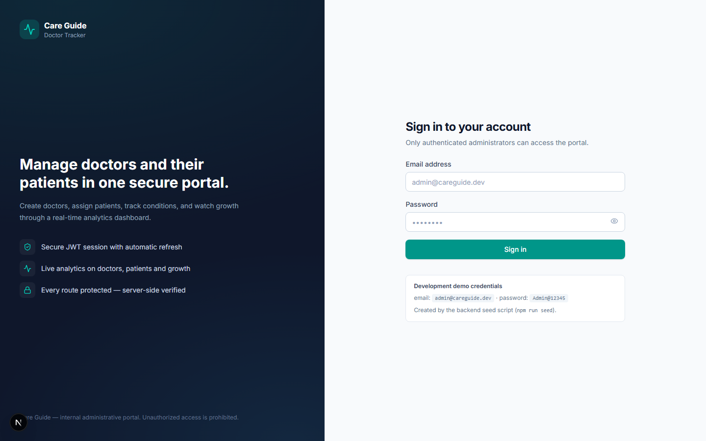
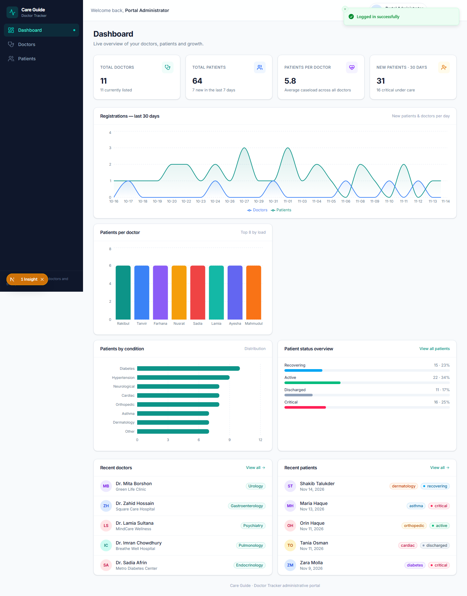
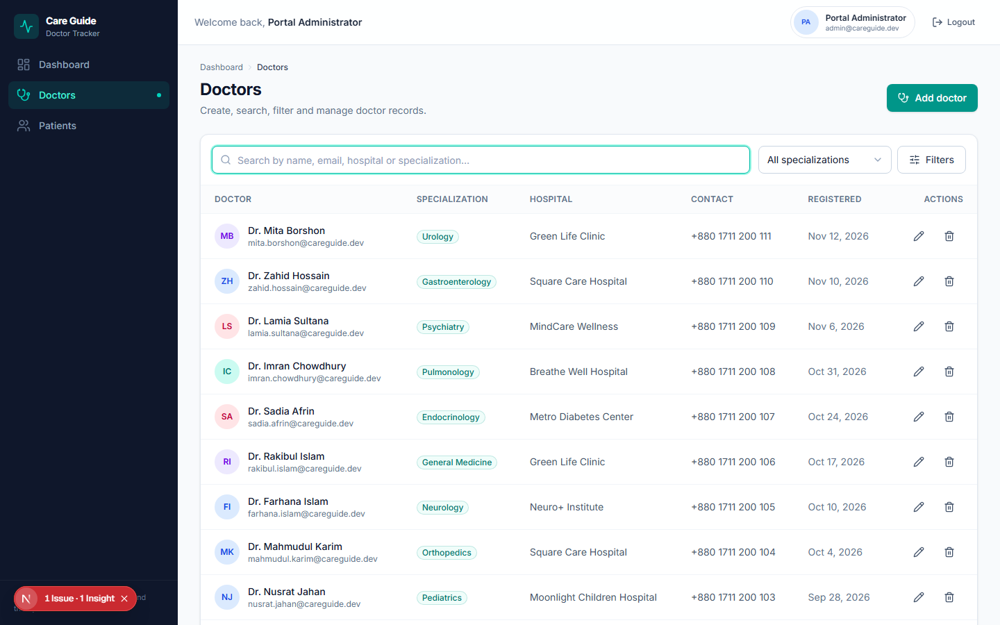
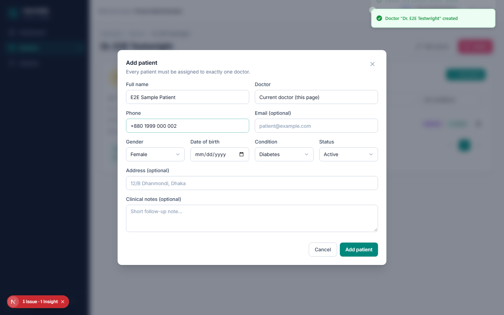
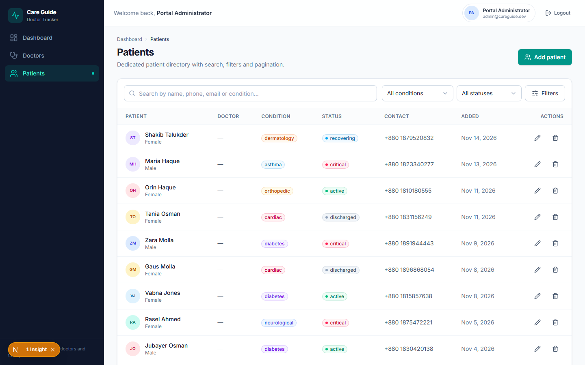
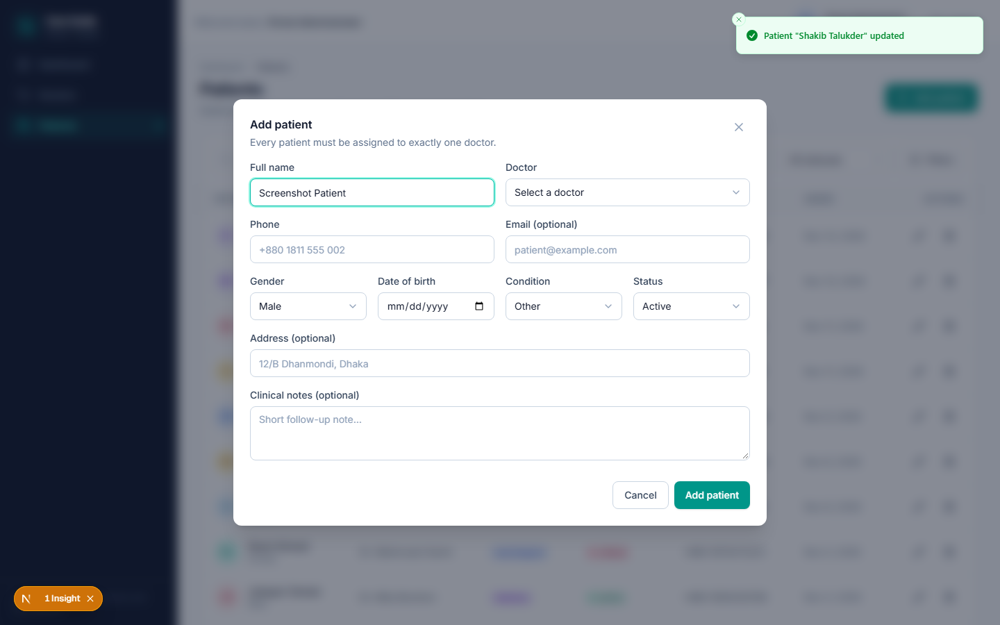
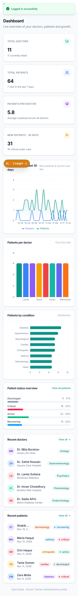
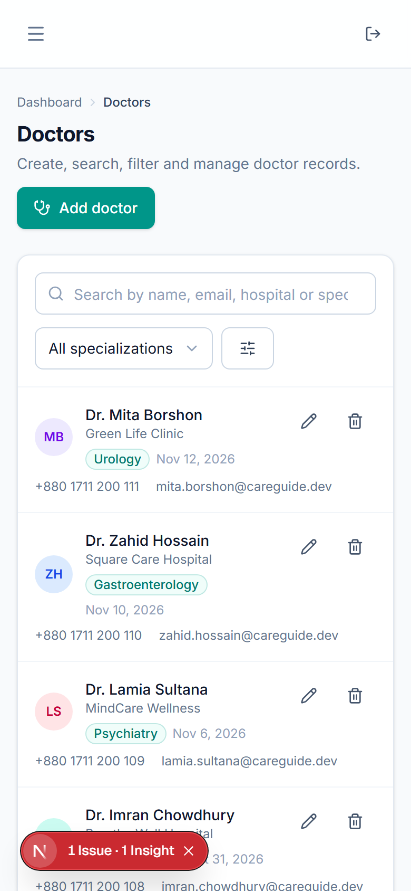

# Doctor Tracker — Frontend

Modern admin portal for the Care Guide / Doctor Tracker system, built with **Next.js 16 (App Router) + React 19 + TypeScript (strict) + Tailwind CSS 4**. Communicates exclusively with the standalone Express backend over REST.

## Features

- **Authentication** — login page with validation, JWT session with automatic token refresh (single-flight axios interceptor), route protection on every dashboard page, server-side revocation on logout.
- **Dashboard** — stat cards (total doctors, total patients, patients/doctor, 30-day growth), Recharts visualizations (30-day registration area chart, top doctors bar chart, condition distribution), status breakdown bars, recent doctors/patients. All data from live API aggregations.
- **Doctors** — searchable, filterable (specialization, registration date range), sortable, server-paginated table; create/edit dialogs; delete with orphan protection; doctor detail page with the doctor's own patient list, add-patient flow and per-patient removal.
- **Patients** — dedicated directory with search, condition/status/gender/doctor/date filters, pagination, full CRUD, detail page with assigned-doctor card.
- **UX details** — loading skeletons, empty states, error states with retry, toast notifications (sonner), confirmation dialogs (Headless UI, focus-trapped & keyboard accessible), debounced search, responsive layout (mobile drawer navigation, tables → card lists on small screens), breadcrumbs, aria labels.

## Requirements

- Node.js ≥ 20
- The backend running on `http://localhost:4000` (see `../backend/README.md`)

## Installation

```bash
cd frontend
npm install
cp .env.example .env.local   # optional — default already points to localhost:4000
```

### Environment variables

| Variable | Required | Default | Purpose |
|---|---|---|---|
| `NEXT_PUBLIC_API_URL` | no | `http://localhost:4000/api` | REST API base URL |

## Development commands

```bash
npm run dev        # http://localhost:3000
npm run build      # production build
npm start          # serve the production build
npm run lint       # ESLint (next/core-web-vitals + typescript)
npm run typecheck  # tsc --noEmit (strict)
```

## API integration

- `src/lib/api.ts` — axios instance, bearer-token injection, 401 `TOKEN_EXPIRED` auto-refresh + retry, forced sign-out on invalid sessions.
- `src/lib/services/*` — typed endpoint wrappers (auth, doctors, patients, dashboard).
- `src/lib/queries.ts` — TanStack Query keys/options; mutations invalidate affected caches (lists, detail, dashboard).
- `src/lib/auth-context.tsx` — session state (restores from storage, verifies via `/auth/me`, logout revokes refresh token server-side).

## Project structure

```
src/
├── app/
│   ├── login/page.tsx            split-screen login
│   ├── (dashboard)/              protected layout + pages
│   │   ├── dashboard/            analytics dashboard
│   │   ├── doctors/[id]/         doctor list & detail
│   │   └── patients/[id]/        patient directory & detail
│   ├── layout.tsx                fonts, providers, metadata
│   └── providers.tsx             TanStack Query + Toaster
├── components/
│   ├── ui/                       Button, Card, Input, Select, Badge, Dialog,
│   │                             ConfirmDialog, Skeleton, Pagination, EmptyState…
│   ├── layout/                   Sidebar (desktop + mobile drawer), Topbar
│   ├── dashboard/                StatCard, chart components
│   ├── doctors/                  DoctorFormDialog
│   └── patients/                 PatientFormDialog
├── hooks/                        useDebounce, mutation hooks
├── lib/                          api client, auth store/context, services, utils
└── types/                        shared API types
```

## Testing

- `npm run lint` and `npm run typecheck` must pass (both are part of CI hygiene).
- `npm run build` performs the strict production build with type checking.
- End-to-end browser verification (login → dashboard → CRUD flows) is executed with a Playwright harness; the captured evidence is committed under [`docs/screenshots/`](docs/screenshots/) and shown below.

## Visual evidence

Genuine Playwright captures of the running application (backend + frontend + MongoDB):

### Desktop (1440×900)

| Login | Dashboard |
|---|---|
|  |  |

| Doctors listing | Doctor detail + patients |
|---|---|
|  |  |

| Patients directory | Patient form dialog |
|---|---|
|  |  |

### Mobile (390×844)

| Dashboard | Doctors |
|---|---|
|  |  |
